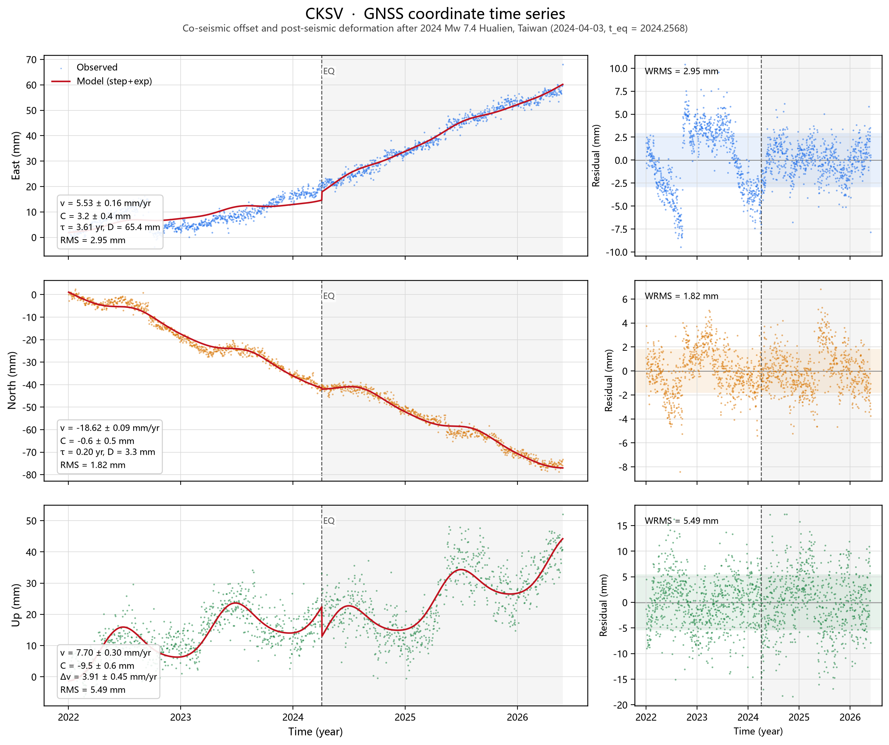

# GNSS 形变监测分析（GPS-DeformationMonitoring）

基于 GNSS 坐标时间序列的形变分析工具：把**长期速度**、**周年/半周年季节项**、**同震阶跃**与
**震后松弛**放进同一个最小二乘模型联合解算，并输出参数精度、拟合优度与成图。

以台湾 CKSV 站 2022–2026 年日采样坐标序列为例，分析 2024-04-03 花莲 Mw 7.4 地震前后的形变。

[](https://github.com/zbf1154-ctrl/GPS-DeformationMonitoring/actions/workflows/tests.yml)
[](https://www.python.org/)
[](LICENSE)



## 目录


- [快速开始](#快速开始)
- [分析模型](#分析模型)
- [使用方法](#使用方法)
- [结果](#结果)
- [输出文件](#输出文件)
- [项目结构](#项目结构)
- [测试](#测试)
- [说明与局限](#说明与局限)
- [数据来源与许可](#数据来源与许可)

## 快速开始

```bash
git clone https://github.com/zbf1154-ctrl/GPS-DeformationMonitoring.git
cd GPS-DeformationMonitoring

# 建议使用虚拟环境
python -m venv .venv
# Windows
.venv\Scripts\activate
# Linux / macOS
source .venv/bin/activate

pip install -r requirements.txt
# 或安装为可执行包（含测试依赖）
pip install -e ".[dev]"

python main.py            # 自动读取 data/ 下的 CSV，结果写入 outputs/
python main.py --show     # 运行并弹出图形窗口
```

## 分析模型

对任一坐标分量（East / North / Up）建立如下模型：

```text
y(t) = a + v·(t − t0)                             # 长期线性趋势
     + Σ_{k=1..K} [ s_k·sin(2πk t) + c_k·cos(2πk t) ]   # 周年、半周年季节项
     + H(t − t_eq)·[ C + D·(1 − e^{−(t − t_eq)/τ}) ]    # 同震阶跃 + 震后指数松弛
     + H(t − t_eq)·Δv·(t − t_eq)                         # 震后速率变化（可选）
```

- `H(·)` 为 Heaviside 阶跃函数，`t_eq` 为同震时刻（2024-04-03 对应十进制年 2024.2568）；
- `C` 为同震阶跃，`D`/`τ` 为震后松弛振幅与时间常数，`Δv` 为震后速率变化；
- 参数用带边界的非线性最小二乘（`scipy.optimize.least_squares`，trust-region reflective）估计，
  τ 以对数参数化保证为正，并用多起点搜索避免 `D`–`τ` 强相关带来的局部极小；
- 不确定度由 `σ₀²(JᵀJ)⁻¹` 给出，`σ₀²` 为残差方差。

模型的三个候选结构：

| 模型 | 含有的震后项 | 适用情形 |
| --- | --- | --- |
| `step` | 仅同震阶跃 | 震后无明显瞬变 |
| `step+exp` | 阶跃 + 指数松弛 | 震后瞬变随时间衰减 |
| `step+rate` | 阶跃 + 速率变化 | 震后进入新的稳定速率 |

`--model auto`（默认）按 BIC 选择，标准为 `BIC = n·ln(SSR/n) + k·ln(n)`。

## 使用方法

```bash
# 显式指定数据与输出目录
python main.py --csv data/CKSV站点坐标数据.csv --output-dir outputs

# 按形式中误差加权、使用稳健损失
python main.py --weighted --robust

# 固定模型结构
python main.py --model step+exp+rate

# 指定地震事件与时间范围
python main.py --eq-date 2024-04-03 --eq-name "2024 Mw 7.4 Hualien" --year-range 2022 2026

# 也可以作为模块或命令运行
python -m gnss_deformation --help
gnss-deformation --help
```

主要参数：

| 参数 | 说明 | 默认值 |
| --- | --- | --- |
| `--csv` | 数据文件 | 自动查找 `data/*.csv` |
| `--station` | 站点名 | 从 `site` 列或文件名推断 |
| `--year-range START END` | 时间筛选（十进制年） | 使用全部历元 |
| `--eq-date` | 同震日期 `YYYY-MM-DD` | `2024-04-03` |
| `--model` | `auto` / `step` / `step+exp` / `step+rate` / `step+exp+rate` | `auto` |
| `--harmonics` | 季节项谐波个数（0/1/2） | `2` |
| `--tau-bounds MIN MAX` | τ 搜索区间（年） | `0.02 5.0` |
| `--weighted` | 用 `sig_*` 加权 | 关闭 |
| `--robust` | Huber 稳健损失 | 关闭 |
| `--reference` | `first` / `mean` 参考基准 | `first` |
| `--no-plot` / `--show` | 不绘图 / 交互显示 | 保存不显示 |
| `--quiet` | 不打印文字报告 | 关闭 |

## 结果

数据：CKSV 站，1530 个历元，2022.0014–2026.4038；事件：2024-04-03 花莲 Mw 7.4 地震。
默认等权最小二乘、`--model auto`：

| 分量 | 模型 | 速度 v (mm/yr) | 阶跃 C (mm) | 松弛 D (mm) | τ (yr) | Δv (mm/yr) | RMS (mm) |
| :---: | :---: | :---: | :---: | :---: | :---: | :---: | :---: |
| East | step+exp | **5.53 ± 0.16** | 3.2 ± 0.4 | 65.4 ± 8.7 | 3.61 ± 0.65 | — | 2.95 |
| North | step+exp | **−18.62 ± 0.09** | −0.6 ± 0.5 | 3.3 ± 0.5 | 0.20 ± 0.05 | — | 1.82 |
| Up | step+rate | **7.70 ± 0.30** | −9.5 ± 0.6 | — | — | 3.91 ± 0.45 | 5.49 |

几点解读：

- **北向以长期匀速运动为主**（−18.6 mm/yr），同震阶跃 −0.6 ± 0.5 mm 在 1σ 意义下不显著，
  仅解出小幅度快速松弛（D≈3.3 mm，τ≈0.2 yr）。
- **东向在震后明显加速**：同震阶跃 3.2 ± 0.4 mm，随后表现为长松弛时间（τ≈3.6 yr）的指数瞬变，
  震后视速率 `D/τ ≈ 18 mm/yr`，说明观测窗口内仍处于松弛早期。
- **垂直方向**解出 −9.5 ± 0.6 mm 的同震下沉，震后速率变化 +3.9 mm/yr。
- `--weighted` 会按 `sig_*` 加权，结果与上表相差不到 0.1 mm/yr；但 χ²_red 明显大于 1
  （East ≈ 10），说明形式中误差被低估、序列存在有色噪声，真实不确定度应大于表中 1σ。

## 输出文件

运行后 `outputs/` 目录包含：

| 文件 | 内容 |
| --- | --- |
| `CKSV_deformation.png` | 三分量时间序列、模型曲线与残差图 |
| `CKSV_parameters.csv` | 各分量参数表（含 1σ） |
| `CKSV_timeseries.csv` | 观测、模型值、残差与中误差的逐历元对照 |
| `CKSV_summary.md` | Markdown 报告（参数表、模型公式、告警） |
| `CKSV_results.json` | 机器可读的完整结果（含候选模型 BIC） |

## 项目结构

```text
GPS-DeformationMonitoring/
├── data/
│   ├── CKSV站点坐标数据.csv      # 原始 GNSS 坐标时间序列
│   ├── CKSV站点坐标数据.xlsx     # 同一数据的 Excel 副本（仅存档）
│   └── README.md                 # 字段说明
├── docs/figures/                 # README 插图
├── gnss_deformation/
│   ├── __init__.py               # 对外 API
│   ├── __main__.py               # python -m gnss_deformation
│   ├── _version.py
│   ├── cli.py                    # 命令行接口
│   ├── config.py                 # 配置与地震事件
│   ├── data.py                   # 读取、清洗、单位换算
│   ├── models.py                 # 模型、拟合、模型选择
│   ├── analysis.py               # 逐分量分析编排
│   ├── plotting.py               # 成图
│   └── reporting.py              # 控制台/Markdown/CSV/JSON 输出
├── tests/                        # 39 项单元测试
├── .github/workflows/tests.yml   # CI：Python 3.10/3.12/3.13
├── main.py                       # 入口（兼容 python main.py）
├── pyproject.toml
├── requirements.txt
├── LICENSE
└── README.md
```

作为库使用：

```python
from gnss_deformation import AnalysisConfig, analyze_station, load_station_data

data = load_station_data("data/CKSV站点坐标数据.csv")
analysis = analyze_station(data, AnalysisConfig(model="auto"))
print(analysis.table())              # DataFrame
print(analysis.fits["East"].velocity, analysis.fits["East"].velocity_error)
```

## 测试

```bash
pip install -e ".[dev]"
pytest
```

测试覆盖数据清洗、模型参数恢复、BIC 模型选择、加权/稳健拟合、CLI 端到端流程与成图，
全部使用合成数据，不依赖 `data/` 中的真实观测。

## 说明与局限

- **仅考虑单个同震事件**。序列中若存在其他地震跳变或天线更换，会以残差形式进入噪声，
  可通过扩展模型（增加阶跃项）或先做阶跃探测处理。
- **τ 的可靠性依赖震后窗口长度**。若震后数据仅两三年，`D` 与 `τ` 高度相关，二者单独的形式精度
  会偏乐观，应优先解释 `D/τ`（震后视速率）或改用 `Δv`。
- **形式精度基于白噪声假设**。实际 GNSS 序列存在闪烁噪声/随机游走，建议用 CATS、Hector 等
  工具估计噪声模型后再评定速度不确定度。
- 坐标已按参考历元归零，输出的是**相对形变**，不是绝对坐标。

## 数据来源与许可

- 观测数据：CKSV 站 GNSS 坐标时间序列（随项目提供，字段见 [`data/README.md`](data/README.md)）。
- 代码以 [MIT License](LICENSE) 发布，欢迎提交 Issue 与 Pull Request。
